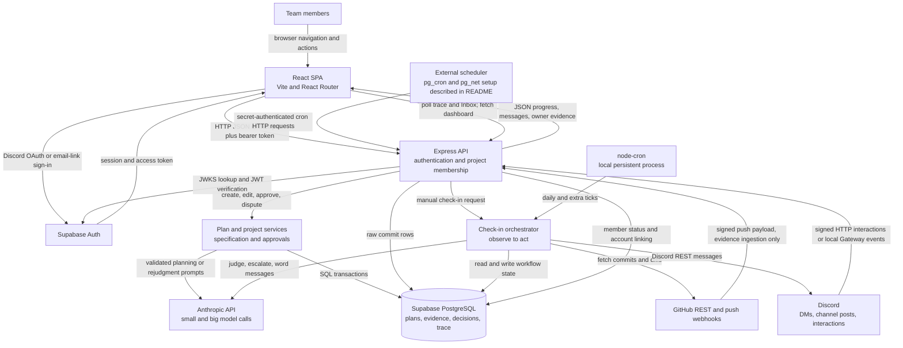
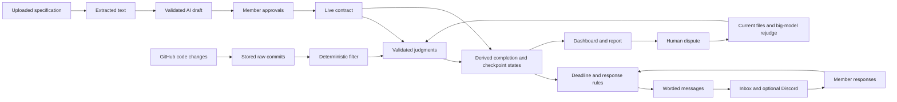
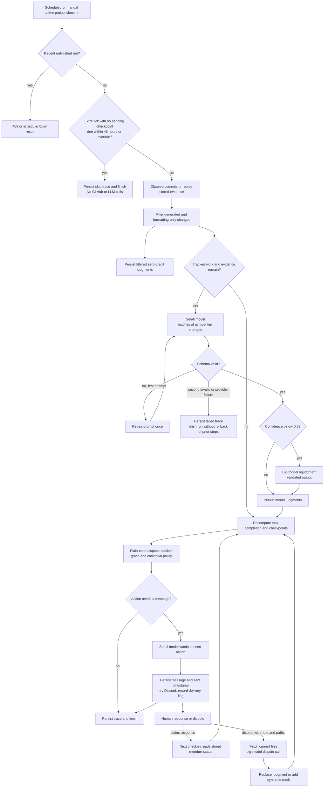
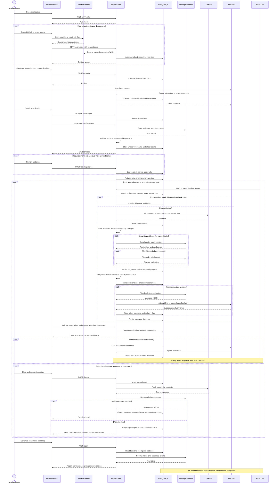

# Enforcer — Technical Architecture

> Source-based architecture reference, engineering onboarding guide, and judging-panel walkthrough.
>
> **Repository:** <https://github.com/alecboudreau/CodeJam16>  
> **Analyzed revision:** `602e258` on `origin/main` (`Merge pull request #100 from alecboudreau/b/demo-guide`), fetched 2026-11-22.  
> **Scope:** committed repository contents at that revision. The source was exported into an isolated directory for inspection; creating this document does not update application code. Local working-copy changes, deployed infrastructure, account settings, issue status, and third-party service availability are not evidence of implementation here.
>
> **Evidence convention:** “Implemented” means a concrete source path implements the behavior. “Configuration required” means code exists but an operator must provision external settings. “Inference” identifies an architectural interpretation. “Recommendation” describes something not implemented. Source links are relative to the repository root; identifiers and endpoints refer to the analyzed revision.

## Table of contents

1. [System overview](#1-system-overview)
2. [Architecture and component boundaries](#2-architecture-and-component-boundaries)
3. [Technology stack](#3-technology-stack)
4. [Persistence and state ownership](#4-persistence-and-state-ownership)
5. [API and component communication](#5-api-and-component-communication)
6. [AI and agentic architecture](#6-ai-and-agentic-architecture)
7. [Complete operational lifecycle](#7-complete-operational-lifecycle)
8. [External integrations](#8-external-integrations)
9. [Practical end-to-end example](#9-practical-end-to-end-example)
10. [Frontend behavior and presentation](#10-frontend-behavior-and-presentation)
11. [Configuration, deployment, and development](#11-configuration-deployment-and-development)
12. [Repository architecture map and reading order](#12-repository-architecture-map-and-reading-order)
13. [Security, reliability, and scalability](#13-security-reliability-and-scalability)
14. [Architectural strengths, limitations, and expansion](#14-architectural-strengths-limitations-and-expansion)
15. [Source cross-reference and verification record](#15-source-cross-reference-and-verification-record)

## 1. System overview

### 1.1 Explanation for a nontechnical reader

Enforcer helps student software-project teams agree on responsibilities and notice unfinished work before the final deadline. A team supplies its specification, repositories, members, and deadline. AI proposes tasks and concrete checkpoints. Members review and accept the plan. The application periodically reads code changes, estimates which planned requirements those changes advance, and checks whether each checkpoint has reached its agreed target.

A missed checkpoint produces a private reminder first. If the work remains unfinished after the team's grace period, the system can post a neutral team alert. A member can say they are working on it, identify someone blocking them, request help, or dispute an incorrect judgment. The website shows progress, personal evidence, messages, and the steps the checking workflow took.

The intended users are student project teams; the repository frames the product as coordination rather than grading. It does not implement academic marks, member rankings, or a professor administration system. “PayLite” is the demonstration team's sample payments project, not a payment-processing product implemented by Enforcer.

### 1.2 Technical explanation

Enforcer is a TypeScript npm-workspace application with a React single-page frontend, an Express API, shared TypeScript/Zod contracts, and Supabase-hosted PostgreSQL. An application-controlled workflow runs:

`observe → filter → judge → confidence escalation → recompute progress → deterministic decision rules → message wording and delivery`.

GitHub REST supplies commit diffs and current file contents. Anthropic supplies bounded JSON completions. Discord supplies private/group communication and interaction events. Supabase Auth supplies browser sessions; the backend verifies tokens and resolves project membership. The same Express application runs as a local persistent server or a bundled Vercel function.

This is best characterized as a **modular monolith with a bounded, stateful AI workflow**. There is no microservice fleet, agent delegation framework, vector database, model-owned tool loop, or autonomous code executor. This characterization is an inference from the module boundaries and call graph, not a framework declared by the repository.

### 1.3 Automated versus human-controlled work

| Responsibility | Implemented owner |
| --- | --- |
| Create project, supply specification, identify members, configure integrations | Human users/operators |
| Draft or propose a revised task plan | Big model, invoked by a human HTTP request |
| Approve initial personal/shared commitments | Members, under API approval rules |
| Accept an already-live contract as a late invitee | Joining action records acceptance of current terms |
| Acquire and filter code evidence | GitHub adapter and deterministic filter |
| Estimate evidence contribution and uncertainty | Small model; uncertain cases use big model |
| Compute completion, deadline state, grace, cooldown, escalation | Deterministic application code |
| Compose messages and status reports | Small model |
| Deliver reminders, store Inbox, record trace | Backend and Discord REST adapter |
| Report blocker/help status or dispute a result | Human, through Inbox or Discord; disputes through website API |
| Resolve dispute evidence | Big model plus deterministic progress recomputation |
| Declare a project archived or formally submitted | No corresponding lifecycle operation implemented |

The distinctive combination is consent-oriented task planning, selective model use, deadline-based interventions, a private evidence view, and an explicit correction path. These are code-supported mechanisms; whether they improve real teamwork is not established by repository evidence alone.

## 2. Architecture and component boundaries

### 2.1 System diagram



The scheduler node represents an externally provisioned service, not an automatically deployed repository resource. On local development, Discord Gateway events enter `discord/interactions.ts` directly rather than traversing Express.

### 2.2 Major components

| Component | Purpose and inputs | Outputs and dependencies | Interaction boundary |
| --- | --- | --- | --- |
| Frontend shell, `frontend/src/App.tsx` | Route, auth/session status, selected project/member | Route pages and project/auth contexts | Calls API client; owns browser selection, not authoritative membership |
| Browser transport, `frontend/src/api/client.ts` | Typed method calls, form data, current access token | HTTP requests or in-memory fixture results; `ApiError` | `fetch`, Supabase session helper, demo presenter header |
| API composition, `backend/src/app.ts` | HTTP requests | Route responses, normalized errors | CORS; raw webhook parser; JSON/raw-byte capture; guards; routers |
| Project/contract routes | Project inputs, specification text, edited terms, approvals | Persisted project, live or pending plan, acceptance records | Zod, DB transactions, big-model prompts |
| Check-in workflow, `backend/src/agent/loop.ts` | Project ID, run kind, optional clock and delivery overrides | Check-in ID, completion promise, persisted trace/state/actions | GitHub, filter/judge, progress, decide, act |
| Progress and policy, `agent/progress.ts`, `agent/decide.ts` | Judgments, tasks, dates, status responses, disputes, sent history | Task completion; checkpoint states; stored decisions | Deterministic code; no LLM selection of notification actions |
| LLM gateway, `backend/src/llm/client.ts` | Purpose, prompts, Zod schema, effort, token limit | Validated object or typed error; token/cost rows | Anthropic SDK, optional exact-prompt cache |
| Persistence, `backend/src/db/db.ts` | SQL operations and typed entities | Rows mapped to shared shapes | `postgres`, `AsyncLocalStorage`, transaction connection reuse |
| External adapters | GitHub repositories; Discord IDs, message/component payloads | Stored evidence, delivered messages, interaction replies | Octokit, Discord REST, optional local Gateway |
| Demonstration subsystem | Seed data, fixture commits, simulated days, presenter key | Public sample project; real workflow runs on a demo clock | PostgreSQL, fixture files, optional cached LLM responses |

### 2.3 Runtime and separation of concerns

- `frontend/src/main.tsx` mounts React with `StrictMode` and `BrowserRouter`.
- `backend/src/app.ts` builds the API without opening a listening socket. This separation permits a serverless export.
- `backend/src/index.ts` opens the local server, starts the Discord bot, and starts `node-cron` after listening.
- `api/index.js` exports the bundled Express app for Vercel. It does not start the local bot or scheduler.
- `shared/src/types.ts` describes entities and responses; `shared/src/schemas.ts` supplies runtime validation for request bodies and model outputs. Some response types, including Inbox and group summaries, remain locally declared instead of centralized.
- Database helpers are a common persistence boundary. They are not an ORM, domain-event bus, or event-sourced store. Evidence and traces form an audit-like history, but much of the domain state is updated in place.

## 3. Technology stack

Versions below are resolved root `node_modules` entries in the committed lockfile, rather than just package manifest ranges. Active usage is verified through imports or invocation sites; installed-only entries are explicitly marked. Model names and prices are repository configuration values, not claims about current provider offerings.

| Technology | Category | Purpose | Where It Is Used | Role in the System |
| ---------- | -------- | ------- | ---------------- | ------------------ |
| TypeScript 5.9.3 | Language/tooling | Shared types and strict checking | All three workspaces; `tsconfig.base.json` | Connects UI, API, and model-output shapes; compiler uses `noEmit` |
| JavaScript ESM | Runtime/configuration | Deployment export and build scripts | `api/index.js`, `backend/scripts/bundle.mjs` | Bridges bundled API into hosting |
| SQL / PostgreSQL | Persistence language/database | Durable multi-project state | `backend/src/db/schema.sql`, `db.ts` | Stores authoritative plan, evidence, decisions, and execution history |
| Node.js 20 baseline | Runtime | Execute backend and tooling | `.nvmrc`, root engine `>=20`, bundler target `node20` | Persistent server or serverless runtime |
| npm workspaces / lockfile v3 | Package management | Shared package resolution and reproducible graph | Root `package.json`, `package-lock.json` | Coordinates frontend/backend/shared development |
| React / React DOM 18.3.1 | UI | Stateful component rendering | `frontend/src/main.tsx`, pages and components | Browser application; contexts and hooks manage local state |
| React Router 6.30.6 | Routing | Client-side routes/navigation | `App.tsx`, page and switcher navigation | SPA flow and project-page selection |
| Vite 6.4.6 / React plugin | Frontend build/dev | TSX transformation, dev server, asset build | `frontend/vite.config.ts` | Serves port 5173 locally; produces `frontend/dist` |
| Tailwind CSS 4.3.5 / Vite plugin | Styling | Utilities alongside custom CSS | `frontend/src/index.css`, TSX classes | Shared visual system and responsive layouts |
| Native SVG / browser DOM | Visualization and UI primitives | Progress timeline and icon rendering | `frontend/src/components/ActivityTimeline.tsx`, `Icon.tsx` | Hand-written accessible vector chart; no chart-library call |
| Recharts 2.15.4 | Installed visualization dependency | No active source import found | `frontend/package.json`, lockfile | Installed but unused at this revision; not the timeline renderer |
| Express 4.22.3 | HTTP framework | Routing, parsers, middleware | `backend/src/app.ts`, routers | Main API boundary |
| cors 2.8.6 | HTTP middleware | Allow configured frontend origin | `app.ts` | Local split-origin access; not authentication |
| Zod 3.25.76 | Runtime validation | Validate API bodies and AI JSON | Shared schemas and prompt-specific refinements | Rejects malformed or inconsistent structured data |
| postgres 3.4.7 | Database driver | Parameterized asynchronous SQL and transactions | `backend/src/db/db.ts` | Direct privileged database connection, pool size five per process |
| Supabase Postgres | Hosted persistence | Operational database | `DATABASE_URL`, schema RLS statements | Hosting choice confirmed by configuration and code comments; provisioning is external |
| Supabase Auth / supabase-js 2.74.0 | Identity | Discord OAuth and email-link sessions | `frontend/src/auth/supabase.ts` | Auth provider only; browser application data uses Express |
| jose 6.1.0 | JWT cryptography | Remote JWKS verification, issuer/audience checks | `backend/src/auth/auth.ts` | Verifies Supabase bearer tokens |
| Anthropic SDK 1.12.0 | AI provider SDK | Message completions and big-model refusal fallback | `backend/src/llm/client.ts` | Only model-call gateway |
| `claude-haiku-5-5` | Configured small model | Batch judging, message wording, report generation | `config.smallModel`, `callSmall` | Low-effort default model tier |
| `claude-sonnet-5-5` | Configured big model | Plans, replans, low-confidence cases, disputes | `config.bigModel`, `callBig` | Medium default effort; planning explicitly requests high |
| Custom workflow modules | Agent orchestration | Bounded observation/evaluation/action cycle | `backend/src/agent/` | No third-party agent framework or model delegation |
| Octokit REST 21.1.1 | GitHub SDK | Commits, diffs, file contents and repository trees | `backend/src/github/client.ts` | Repository evidence acquisition |
| GitHub push webhooks | Event integration | Pre-ingest default-branch evidence | `github/webhook.ts`, `routes/webhook.ts` | HMAC-authenticated ingestion; never directly triggers judgment |
| discord.js 14.28.1 | Discord Gateway SDK | Receive interactions in persistent development server | `discord/bot.ts`, `discord/interactions.ts` | Local reception only; outbound delivery uses REST |
| Discord HTTP API v10 / native fetch | Notification integration | Send DMs/channel messages; register guild command | `discord/rest.ts` | Works locally and on serverless hosting |
| Node crypto | Security primitives | HMAC, Ed25519 verification, constant-time comparisons, IDs, cache hashing | Webhooks, Discord, demo/cron guards, DB, LLM cache | Authenticates external events and derives identifiers |
| node-cron 3.0.3 | Local scheduling | Daily and conditional extra ticks | `backend/src/scheduler/cron.ts` | Runs only in persistent server entry point |
| Supabase pg_cron / pg_net | External scheduling setup | Invoke authenticated cron HTTP endpoints | README setup; `routes/cron.ts` receiver | Described deployment integration, not provisioned by source migrations |
| `@vercel/functions` 2.2.13 | Serverless lifecycle | `waitUntil` background promise retention | `backend/src/platform.ts` | Keeps accepted check-ins and cron work alive after HTTP response, within platform limits |
| Vercel | Hosting | Static frontend and one API function | `vercel.json`, `api/index.js` | Repository config sets region `iad1` and 300-second maximum function duration |
| esbuild 0.28.2 | Backend bundling | Bundle own TS modules and shared workspace source | `backend/scripts/bundle.mjs` | Produces ESM `backend/dist/app.js`; installed transitively, not declared directly by backend |
| Multer 2.5.0 | Multipart parsing | In-memory, single-file spec upload | `routes/spec.ts` | Enforces four-MiB file limit |
| pdf-parse 1.1.4 | Document extraction | PDF selectable text extraction | `spec/extract.ts` | No OCR pipeline |
| mammoth 1.13.0 | Document extraction | DOCX raw text extraction | `spec/extract.ts` | Does not support legacy `.doc` |
| dotenv 16.6.1 | Configuration | Load root `.env` | `backend/src/config.ts` | Development environment loading |
| tsx 4.23.15 / concurrently 10.0.7 | Development tools | Execute/watch TS and start both processes | Package scripts | Local workflow and focused integration test execution |
| Node test/assert | Verification | Contract-joining integration test | `backend/test/contract-join.test.ts` | Isolated PostgreSQL schema test; skips without database configuration |
| Web manifest and Apple metadata | Browser installation | Standalone launch metadata/icons | `frontend/public/manifest.webmanifest`, `index.html` | Installable shell metadata; no service-worker/offline implementation found |

**Confirmed versus inferred rationale.** Batching, filtering, confidence escalation, and compute logging explicitly implement the repository's compute-efficiency intent. Direct REST delivery explicitly supports serverless operation. It is a reasonable architectural inference that workspaces/shared schemas reduce contract drift and that the modular monolith reduces hackathon deployment complexity; the code does not establish a broader vendor-selection study. Legacy `DATABASE_PATH` and a root `allowScripts` entry for `better-sqlite3` do not mean SQLite is an active database: no current SQLite driver call exists in the persistence layer.

## 4. Persistence and state ownership

### 4.1 Database access

`backend/src/db/db.ts` lazily creates a `postgres` pool with `prepare: false`, `max: 5`, and a 20-second idle timeout. Its comments associate disabled prepared statements with Supabase's transaction pooler. `dbAll`, `dbGet`, and `dbRun` translate `?` placeholders into numbered PostgreSQL parameters. Values are bound parameters; selected internal table names and test schema identifiers are constructed separately.

`tx()` uses `AsyncLocalStorage` to make nested helper calls reuse the transaction connection. A nested `tx()` joins its parent's transaction rather than opening a new nested transaction/savepoint. Contract editing/approval and late-member acceptance lock the project row; applying a pending plan also locks task/checkpoint rows. Other operations have different concurrency guarantees, described in Section 13.

`initDb()` reads and executes `schema.sql`. Neither the local HTTP startup nor the Vercel export automatically migrates the schema. Schema initialization is an explicit operational step (`npm run db:init`). Vercel demo reset deliberately skips initialization because its deployment does not bundle `schema.sql`.

### 4.2 Entity map

| Table / primary identifier | Information stored | Relationships and use |
| --- | --- | --- |
| `projects` / `id` | Repositories, deadline, extracted specification, active/version flags, grace settings and approvals, pending plan, demo clock, invite code | Parent scope for members, tasks, evidence and check-ins; pending plan is serialized JSON text |
| `members` / `id` | Name, GitHub login/aliases, optional email/Discord ID/capacity, current status/blocker/time, join-acceptance version/time/pending flag | Belongs to project; owns tasks and personal checkpoints; status is member-wide |
| `tasks` / `id` | Title/description, effort points, owner, paths, tracked flag, dependencies, completion and approvals | Belongs to project; parent of checkpoints; completion recomputed from judgments |
| `checkpoints` / `id` | Task/owner, criteria, due date, target fraction, state, approvals, missed/grace times | Null owner means shared approval; responsible reminder recipient falls back to task owner |
| `raw_commits` / global `sha` | Project/repo, author/coauthors, message/time, file list and diff, receipt time | Durable source evidence; insert-on-conflict avoids duplicate SHA rows |
| `judgments` / global `sha` | Project/task, authors/unmatched login, kind, fractional delta, confidence, tier, reason, originating check-in | One matched task per SHA; updates replace a prior judgment; repo is joined from raw commit |
| `disputes` / `id` | Target kind/ID, checkpoint to pause, requester, note/paths, status, before/after/reason/timestamps | Correction record and input to notification suppression |
| `checkins` / `id` | Project, kind, skipped flag, project-time start, real-time start, finish time | Parent for trace and decisions; no explicit success/failure column |
| `trace_steps` / no declared primary key | Check-in, order, step, summary, JSON details, wall-clock time | Ordered execution trace; includes failure summaries |
| `decisions` / `id` | Check-in, recipient/checkpoint, action/reason, worded message, sent time, Discord delivery flag | Also serves as Inbox persistence; no separate Inbox message table |
| `llm_calls` / `id` | Project/check-in, purpose/model, token counts, configured USD/Wh estimates, timestamp | Compute meter and audit of model consumption |

The schema uses text-encoded JSON arrays/objects, ISO timestamp text, integer booleans, and application-generated IDs. `seq BIGSERIAL` supplies insertion ordering for selected tables. It defines indexes on commonly queried project/member/check-in fields and a unique project invite-code index. It does **not** define foreign-key relationships, most non-null constraints, fraction checks, or enum checks: those relationships are application-enforced.

All eleven application tables enable row-level security without public-access policies. The backend is expected to connect as a database owner that bypasses RLS; browsers do not issue application-data queries through Supabase's public REST interface. Actual database grants and role ownership require external verification.

### 4.3 State ownership and time

- PostgreSQL owns live terms, approvals, progress, evidence, decisions, and statuses.
- React context owns the currently displayed project/member. With auth enabled, `/projects/:id/me` resolves the real viewer; browser picker values are not trusted by the backend.
- `localStorage` retains selected project (`enforcer:project:mock` or `enforcer:project:live`), per-project viewer choice, some UI preferences, and the presenter key. `sessionStorage` marks demo mode per tab.
- The Supabase browser SDK manages the auth session and access-token refresh.
- The in-memory mock API is a separate, nonpersistent backend simulation. Refreshing the document recreates its module state. It is not the production database or AI engine.
- Project time uses `projects.demo_now` when present; otherwise real time. Check-in `real_started_at` is wall time for stale-run detection. Trace timestamps and member-button timestamps are wall time; notification/cooldown timestamps use the check-in clock. These distinct clocks matter when explaining demo behavior.

### 4.4 Contract transitions

Initial tasks and personal checkpoints require their owners' approvals; shared checkpoints and grace require every member. `computeWaitingOn()` derives missing approvals. `POST /taskmap/agree` activates a nonempty fully approved plan and increments its version.

`PUT /taskmap` and AI replan save changed live terms as `pending_plan`; unchanged items retain approvals, while changed items lose the relevant approvals. The current live contract stays active. Final approval applies the proposal with current progress/status merged back in and increments the version.

Late invitees are marked `contract_join_pending` at insertion if the plan is already active. `joinGroup()` calls `acceptContractOnJoin()` once to add acceptance to current owned tasks, personal/shared checkpoints, and grace, and record the accepted version/time. It does not rewrite progress or accept pending proposals. The UI distinguishes “Accepted on joining” from a signature. The migration backfills legacy late invitees missing live grace approval. Rejoining cannot accept later terms again.

**Important exception:** the direct task, checkpoint-date, and deadline editing endpoints used by Project info apply immediately, without the proposal approval flow. Direct task edits set `approvedBy: [ownerId]` without a separate action by that owner. This is implemented behavior, not a claim that every change requires consent.

## 5. API and component communication

### 5.1 HTTP boundary and middleware ordering

All backend route paths below have the `/api` prefix added by `app.ts`.

1. CORS allows `config.frontendUrl`.
2. GitHub webhook router parses raw `application/json` with a 25-MiB parser limit, compression disabled, and verifies the original bytes.
3. General JSON parsing limits input to `4mb` and captures raw bytes for Discord signatures.
4. Health, Discord interactions, and secret-authenticated cron routes are mounted.
5. `requireSignIn` verifies bearer tokens when auth is enabled; `requireMember` gates project routes and replaces supplied viewer/member identity fields with resolved membership.
6. Functional routers handle project/plan/workflow/query operations.
7. Zod errors become 400 responses; other uncaught errors become 500 with a logged error and its message.

The browser normally uses JSON request/response bodies, with `FormData` for specification upload. Browser updates are HTTP polling/refetching, not WebSockets, server-sent events, Supabase Realtime subscriptions, or browser push notifications.

### 5.2 Endpoint inventory

`projects/:id` means a membership-guarded project scope when normal authentication is enabled. The public demo scope and auth-disabled mode are exceptions. More specific validation is implemented in each router.

| Method and path | Input / trigger | Result and source |
| --- | --- | --- |
| `GET /health` | Liveness probe | `{ok:true}`; no DB/provider readiness check (`app.ts`) |
| `GET /auth/config` | Browser bootstrap | `{enabled}` (`auth/auth.ts`) |
| `GET /projects/:id/me` | Authenticated project open | Resolved member; 404 when auth disabled or unresolved (`auth/auth.ts`) |
| `GET /me/projects` | Groups/switcher/My work | Groups matching token email/Discord; empty list with auth disabled (`routes/projects.ts`) |
| `POST /me/projects/join` | `{code,githubUsername}` | Links existing listed member to account where allowed; late acceptance; project JSON |
| `POST /projects` | Validated name, repos, members, deadline | 201 project; creator must include their signed-in email |
| `GET /projects/:id` | Project open/switch | Project including member records |
| `POST /projects/:id/members` | New teammate inputs | 201 member; duplicate login checks; public demo blocked |
| `POST /projects/:id/members/:memberId/aliases` | `{githubLogin}` | Updated member; maps unmatched identity |
| `POST /projects/:id/spec` | Multipart `file` | `{chars}` after extraction and storage (`routes/spec.ts`) |
| `POST /projects/:id/taskmap/generate` | Human first-plan action | Big-model draft; requires spec and inactive plan (`routes/taskmap.ts`) |
| `GET /projects/:id/taskmap` | Contract/query | Live terms, pending proposal, version, missing approvals |
| `PUT /projects/:id/taskmap` | Full task/checkpoint/grace body | Save initial draft or pending edit; validate membership, references, cycles and ID scope |
| `POST /projects/:id/taskmap/replan` | Human updated-spec action | Big-model proposal plus summary/change list; demo presenter restriction |
| `POST /projects/:id/taskmap/agree` | Member and optional item references | Approve allowed own/shared items; activate/apply when complete |
| `PUT /projects/:id/deadline` | `{at}` | Immediate project deadline update |
| `POST /projects/:id/tasks` | Validated task edit body | 201 task map; immediate new task |
| `PUT /projects/:id/tasks/:taskId` | Validated task edit body | Immediate task update; owner pre-approved |
| `PUT /projects/:id/checkpoints/:checkpointId` | `{at}` | Immediate checkpoint due-date update |
| `POST /projects/:id/checkin` | Manual action | 202 `{checkinId}`; retains completion promise (`routes/checkin.ts`) |
| `GET /projects/:id/checkins` | Trace history | Newest-first run list |
| `GET /projects/:id/trace?checkinId=` | Trace poll | Ordered steps; latest run if ID omitted; verifies run's project |
| `GET /projects/:id/dashboard?viewerId=` | Dashboard/evidence fetch | Team progress; only viewer's task evidence and disputes (`routes/dashboard.ts`) |
| `GET /projects/:id/meter` | Compute display | Logged versus estimated naive totals |
| `GET /projects/:id/inbox?viewerId=` | Poll/navigation badge | Personal and team messages; unanswered-personal count (`routes/inbox.ts`) |
| `POST /projects/:id/members/:memberId/status` | On it / Blocked / Need help | Own status only; blocker must be another teammate |
| `POST /projects/:id/judgments/:sha/dispute` | Note and optional paths | Immediate rejudgment; owner/author checks; 502 on model-stage failure (`routes/disputes.ts`) |
| `POST /projects/:id/checkpoints/:checkpointId/dispute` | Note and optional paths | Personal owner or member for shared checkpoint; met/duplicate-open rejected |
| `GET /projects/:id/report` | Human generate-report action | Small-model Markdown and generation timestamp (`routes/report.ts`) |
| `POST /projects/:id/simulate` | `days` from 1–14, default 7 | Waits for full simulation, returns last daily run and counts (`routes/simulate.ts`) |
| `POST /webhook/github` | Signed push JSON | 204 after ingestion; non-push events ignored after authentication |
| `POST /discord/interactions` | Ed25519-signed interaction | Ping response, command/button reply or component update (`routes/discord.ts`) |
| `POST /cron/:kind` | Bearer cron secret, `daily` or `extra` | 202; background sequential project tick (`routes/cron.ts`) |
| `POST /demo/reset` | Public demonstration action | Reset shared seeded demo; `{projectId}` (`routes/demo.ts`) |
| `GET /demo/presenter` | Presenter header | Whether supplied key matches |

Direct deadline/task/checkpoint edits reject the demo project. These checks do not make the entire public demo immutable: other routes remain available as implemented.

### 5.3 Significant interaction flows

| Initiator → receiver | Trigger and transferred data | Mechanism / processing | State or user-visible result |
| --- | --- | --- | --- |
| Setup → project API → DB | Submitted team, repos, deadline | Browser Zod prevalidation plus server Zod and duplicate checks | Project and member rows; selected project stored in browser |
| Browser → spec API → DB | PDF/DOCX/text file | Multipart memory upload, extraction/tidying | Plain `spec_text`, not retained original binary |
| Plan API → LLM → DB | Spec, dates, member capacities | Big-model high-effort JSON; project-specific validation; temporary keys mapped to IDs | Draft tasks/checkpoints with zero progress/empty approvals |
| Members → approval API → DB | Own/shared item selections | Server resolves actor; project-row transaction lock | Activation or application of pending proposal |
| Scheduler/manual API → orchestrator | Active project, kind, clock | Database running check; extra-run due gate | Check-in row and asynchronous workflow |
| Observe → GitHub → DB | Repo and `since` cursor | Default-branch commit list/diff; authors parsed; SHA dedup | Durable unjudged raw evidence |
| Filter/judge → LLM → DB | Trimmed diffs and tracked tasks | No-AI filtering; batched estimates; confidence escalation | Filtered or model-derived judgment rows |
| Progress/decide → DB | Judgments, target fractions, time, member status | Deterministic recalculation and policy | Met/missed/alerted state; stored actions |
| Act → LLM → Discord/DB | Chosen action and checkpoint context | Message-only prompt; REST delivery attempt | Inbox persistence and separate Discord delivery flag |
| Discord/Inbox → member state | Member's response/blocker selection | Signature or session/member authorization | Shared `members.status` consumed at later check-in |
| Dispute API → GitHub → big model | Owner note, paths, prior evidence | Fetch current files, bounded prompt, validated correction | Replaced judgment or synthetic evidence; updated progress and trace |
| Frontend → trace/Inbox/dashboard | Poll, focus, refresh, route change | HTTP JSON and identity-scoped UI state | Latest stored execution/status and personal evidence |



## 6. AI and agentic architecture

### 6.1 Model responsibilities and context

Every provider call passes through `callSmall()` or `callBig()` in `backend/src/llm/client.ts`. Defaults are configurable through `SMALL_MODEL` and `BIG_MODEL`.

| Purpose | Tier / effort | Prompt inputs | Validated output and effect |
| --- | --- | --- | --- |
| Initial task map | Big / high | Entire extracted spec up to route's 200,000-character limit, current date/deadline, member names/capacities | Task keys/owners/points/paths/dependencies; checkpoint dates/targets/criteria; grace. Mapped to persisted draft IDs |
| Updated-spec replan | Big / high | New spec, existing task completion, checkpoint states, owner names/capacities, grace, default-branch file list (up to 600 paths per repo) | Complete proposed plan, existing IDs, reasons and summary; saved through normal plan-edit path |
| Commit judging | Small / low | Tracked tasks' title/description/paths/current completion, commit SHA, author names, changed files, first 150 diff lines | Task match or null, substantial/light kind, delta, confidence, reason |
| Confidence escalation | Big / medium | Same task/change prompt for judgments below 0.6 confidence | Replaces small-tier judgment before persistence; not model-to-model conversation |
| Judgment dispute | Big / medium | Prior judgment, disputed diff, task, member note and current files | Revised kind/delta/reason; can increase or decrease effective credit |
| Checkpoint dispute | Big / medium | Task progress, criterion/target/date, judgment reasons, note/current files | Completion and met verdict; extra evidence can increase task completion |
| Notification wording | Small / low | Already-chosen message kind, recipient/owner, task/criterion, private grace context where needed | Message of 1–600 characters; no change to action-selection policy |
| Status report | Small / low | Project/date/deadline, task titles/owners/tracked flags, checkpoint criteria/dates/states | Nonempty Markdown; returned to client rather than persisted as a report entity |

Prompt implementations are in `backend/src/llm/prompts/{taskmap,replan,judge,nudge,report}.ts`. These are ordinary system/user prompts with schema validation; there is no fine-tuning, retrieval-augmented vector search, chain-of-thought persistence, or Anthropic tool-definition invocation in this code.

### 6.2 Evidence acquisition and filtering

`observe()` lists default-branch commits from each configured repo. For a previously checked project, its `since` date is the latest finished, non-skipped, non-dispute check-in start minus **14 days**. The lookback accommodates commits authored earlier but pushed later. A first check-in supplies no `since`, which can retrieve extensive history.

Each unseen SHA is fetched through `getCommitDiff()` and stored. `resolveAuthors()` recognizes primary logins/aliases, GitHub noreply logins, optional email, and coauthor trailers; unresolved primary logins remain visible as unmatched identities. Author identities annotate evidence; task matching is model-driven, not restricted to the matched author's owned tasks.

`filterCommits()` strips lockfiles, generated/build/vendor/dependency paths, minified files, and source maps. It compares normalized added/removed lines to identify formatting-only changes, ignoring whitespace and selected punctuation/quote differences. Such commits receive a stored `filtered` judgment with zero delta and model `none`. This is a heuristic, not a syntax-aware semantic equivalence proof; it can discard meaningful punctuation-sensitive changes.

### 6.3 Actual completion evaluation

`judgeCommits()` batches at most **10 commits** per request. Only tracked tasks are offered for matching. Each commit gets one selected task or null and an estimated fraction of that task's total work. There are no model calls when no evidence survives filtering, and no model is needed when there are no tracked tasks to match.

The small-model output's confidence determines whether a batch of uncertain changes is sent to the big model. Escalation uses the same prompt construction, not a second autonomous agent checking the first one's rationale. All validated results are assembled before this function persists its model judgments.

`agent/progress.ts` then computes:

```text
judgedDelta(j) = 0                              if task is null or judgment is filtered
              = completionDelta × 0.1          if light
              = completionDelta                if substantial

taskCompletion = min(1, round(sum(judgedDelta for task), 3 decimal places))
projectProgress = sum(points × completion) / sum(points), tracked tasks only
```

Untracked tasks remain at zero in this automatic computation and contribute neither automatic checkpoints nor the tracked denominator. Adding a GitHub alias changes identity interpretation/visibility; it does not retroactively run the model or redistribute task credit.

This is more substantive than counting commits: the model receives code diffs and agreed requirements, a filtered commit contributes zero, and a light change contributes only one tenth of its estimated work. However, “actual completion” is still an **LLM estimate**, not an executed acceptance test. Ordinary checking does not run the team's code, evaluate a deployed UI, inspect the complete current source tree, or verify checkpoint criteria independently. It converts accumulated task completion into checkpoint status by threshold. The judge prompt does not include the checkpoint criteria as a separate per-checkpoint test input.

Consequences:

- A commit can advance only one task under the current judgment representation.
- Deltas are additive; overlapping implementation credit can accumulate across commits or batches. Existing task completion in the prompt is a guardrail, not a deterministic overlap detector.
- The ordinary path has nonnegative deltas and no automatic regression detector. Reverts can be misinterpreted unless the model assigns appropriate zero credit.
- Met checkpoints are skipped during subsequent status recomputation. A downward judgment-dispute correction can reduce task completion without automatically reopening an already-met checkpoint.
- These limitations must be distinguished from the product intent of checking functional requirements.

### 6.4 Deterministic policy and action loop

`updateProgress()` recomputes tasks, then:

1. Marks any non-met checkpoint `met` if its task reaches its target, even after an alert.
2. Marks a pending checkpoint `missed` only when `now > dueAt`.
3. Starts grace at **detection time**, `missedAt = now`, not at the original deadline.
4. Sets `graceEndsAt = missedAt + gracePeriodHours`.
5. Clears a blocked member's status when any task owned by their blocker gained progress in that update. It does not require the exact dependency to be completed.

`decide()` processes missed/alerted checkpoints in grace-end order:

- Open dispute: record `wait`; suppress that checkpoint's intervention.
- Blocked member: extend a missed checkpoint's grace by elapsed time since the previous completed check-in; wait and potentially nudge the blocker, respecting cooldown.
- Recent Need help: choose a help post and clear that status. The interaction handler itself does not send the group post.
- Grace expired: change `missed` to `alerted` and choose one `team_alert`.
- Then choose at most one ordinary reminder per member, for the earliest unhandled missed/alerted checkpoint. Honor On it for two days, per-member private-reminder cooldown, and messages already chosen that check-in.

An On it response suppresses private reminders; it does not extend grace or prevent a team alert once grace expires. A dispute suppresses actions while open but does not increment `graceEndsAt` in the way blocked status does. Alerts can therefore become immediately eligible after a dispute ends with the checkpoint still unmet.



The diagram condenses common validation behavior; big-model and message calls use the same JSON-repair gateway. Actual outbound Discord delivery is attempted before `markDecisionSent()` persists the final message/delivery flag; the Inbox remains the logical delivery fallback.

### 6.5 Model gateway, validation, and failure handling

The gateway appends a JSON-only instruction and defaults to `max_tokens: 16000`. It extracts the outermost JSON object, parses it, and applies the requested Zod schema. On malformed JSON or schema failure, it adds the previous response and up to five validation issues to the conversation and retries **once**. Two invalid outputs throw `LlmBadJsonError`.

Prompt-specific validation adds known member names, task keys/IDs, SHA membership, dates, and preservation requirements. The judge refinement checks missing/unknown SHAs and unknown tasks but does not independently reject duplicate judgments for a SHA. Planning prompts ask for increasing targets, a final target of one, and limited shared checkpoints; not all these natural-language constraints are enforced in the initial-plan schema. Edited plans do have a deterministic dependency-cycle check.

Big-model calls use Anthropic's beta server-side refusal fallback configuration. The gateway logs the returned model identity and usage; a returned refusal throws `LlmRefusalError`. The actual provider/fallback model serving any deployed request cannot be established from source alone.

Optional `LLM_CACHE` modes:

- `off`: direct calls.
- `fallback`: save response text/usage under a SHA-256 key derived from model, effort, system prompt and messages; on provider-call exception use the exact matching cache entry. SDK configuration becomes 90-second timeout and one retry.
- `replay`: no provider requests; a missing exact entry throws `LlmCacheMissError`.

Cache responses still pass normal JSON validation. The implementation saves text before the caller's schema-validation outcome, so a cache entry is not proof of a valid final object. Read-only deployments retain new entries only in process memory if writing fails. The checked-in cache is a demonstration artifact, not durable user memory.

Each completed provider response and cache replay logs `llm_calls`; network failures without a response do not have provider token usage to log. Cached responses are logged with their original token counts and configured cost/energy estimates, so the meter does not distinguish actual replay billing from its recorded reference consumption.

### 6.6 Disputes as the feedback path

`routes/disputes.ts` inserts an open dispute and fetches file context before calling `runDispute()`. Judgment disputes require the task owner (or a matching author when no task is assigned); shared-checkpoint disputes permit a project member. Duplicate open disputes and already-met checkpoint disputes are rejected.

Current GitHub file contents, rather than just the original diff, are supplied to the big model: up to five returned files, each trimmed to 200 lines. Directory requests enumerate immediate child files, not a recursive crawl. A directory can be fetched more broadly before the final cap is applied. For `demo/paylite`, local `after` snapshots substitute for GitHub.

A judgment dispute replaces the previous kind/delta/reason. A checkpoint dispute creates positive extra credit as a synthetic judgment `dispute:<disputeId>`; it never reduces progress. A model verdict of `met` raises the target to at least the checkpoint threshold before calculating extra credit. Progress is then recomputed and before/after/reason are stored in the dispute and trace.

Model-stage failure returns 502 and leaves the dispute open; current decision rules continue suppressing its associated checkpoint. There is no dedicated retry/resolution endpoint for an already-open failed dispute. File-fetch failures occur before `runDispute()`'s catch and can leave an open dispute without its own traced rejudge run.

### 6.7 Memory, autonomy, and compute claims

The workflow's memory is explicit relational state: live/pending plan, stored evidence, judgments, decisions, status responses, and execution history. There is no persistent free-form agent conversation except transient JSON-repair messages inside a call. The application, not a model, chooses when to call GitHub, which model tier to use, whether to send a reminder, and where to send it.

The genuine agent-like behavior is a recurring environment-observation and policy-controlled action loop with human feedback and re-evaluation. Schedules, signature verification, filtering, arithmetic, and HTTP handlers are conventional automation; plan/report generation alone is a bounded LLM API call. There are no autonomous subagents communicating or delegating work.

`llm/meter.ts` compares logged consumption with a hypothetical baseline: each raw commit alone to the big model, input estimated as `ceil(diff.length / 4)`, 200 output tokens, plus the same non-judging calls. USD/Wh use repository constants in `config.ts`. These are estimates, not provider invoices, measured electricity, carbon accounting, or a controlled benchmark. The baseline does not model every task-context/token overhead of a real alternative system.

## 7. Complete operational lifecycle

### 7.1 Chronological walkthrough

Each row states the initiator, source boundary, input, processing/output, timing, and next transition. The normal authenticated path is described first; demo and failure branches follow.

| Step | Initiator and implementation | Input → processing → output | Execution and next trigger |
| --- | --- | --- | --- |
| 1. Open website | User; `main.tsx`, `App`, `AuthGate` | Browser URL → React shell queries `/auth/config`; root redirects toward Groups | Async bootstrap. Auth enabled and no session leads to SignIn; mock/demo skips this gate |
| 2. Authenticate | User; `SignIn.tsx`, `auth/supabase.ts` | Discord OAuth choice or email address → Supabase sign-in → session returns to `/groups` | External asynchronous redirect/email interaction; SDK auth event updates AuthGate |
| 3. Resolve existing membership | SPA API client; `GET /me/projects`, `auth/auth.ts`, `db.listGroups` | Bearer JWT → JWKS/issuer/audience validation → matching email/Discord rows and invite summaries | HTTP request; user opens a group, joins an invitation, or starts Setup |
| 4. Create workspace | User; `Setup.submit`, `POST /projects`, `insertProject` | Repos, names/logins, optional emails/capacities, deadline → validation and transaction → project/members/invite code | Sequential async HTTP; browser selects project and begins upload. Duplicate GitHub names or missing creator email fail before completion |
| 5. Connect communication/evidence identity | Operator and each member; Discord registration plus `/link`; GitHub configuration | Operator provisions bot/token/channel; member supplies GitHub username → `linkDiscord()` associates their Discord ID | Gateway event locally or signed HTTP interaction on Vercel. Repo strings already identify evidence sources; no GitHub OAuth handshake exists |
| 6. Join listed team | Teammate; Groups join form or Join group action; `joinGroup` | Invite code and listed login → match existing member, reject conflicting account bindings, attach account identity | HTTP action; late join accepts current live terms once; initial members still sign draft; browser opens contract |
| 7. Upload specification | User/Setup; `POST /spec`, `extractSpecText` | One PDF/DOCX/Markdown/text file → parser/tidy → extracted text saved on project | Synchronous request lifecycle with async extraction/storage; `{chars}` enables plan generation |
| 8. Generate initial draft | Setup; `POST /taskmap/generate` | Text, dates, members/capacity → high-effort big model, schema/refinements → mapped task/checkpoint IDs, grace, empty approvals | Request waits for LLM and DB transaction; successful response navigates to contract. Failed generation leaves project/spec available for retry |
| 9. Review/edit/approve | Members; TaskMap, `PUT /taskmap`, `POST /taskmap/agree` | Edited terms and actor's allowed items → server-owned progress retained, changed approvals reset → draft/missing-approval result | Human synchronous requests, row-locked transactions; final required approval activates versioned plan |
| 10. Wait for checking opportunity | `node-cron`, external `/cron/daily` or `/cron/extra`, or manual button | Active project IDs → skip demo-clock projects in real scheduler; start project run | Scheduled/event-driven HTTP; manual/cron return 202 with background continuation. Inactive project or recent running check-in returns conflict |
| 11. Apply inexpensive run gate | `startCheckin` | Run kind/time and pending checkpoint dates → extra check skips if none due by 48-hour horizon → persisted skip/finished row | Async deterministic branch; skipped run stops without GitHub/model calls; other runs observe |
| 12. Collect evidence | `observe`; optionally earlier GitHub webhook | Repo list and lookback → default-branch commit pagination, unseen diff acquisition, coauthor parsing → `raw_commits` | Async external API. Webhook may already have stored evidence, but never starts a model run. Unjudged rows proceed to filtering |
| 13. Filter and evaluate | `filterCommits`, `judgeCommits`, LLM gateway | Raw diffs → filtered zero-credit entries; surviving batches → small model and optional big escalation → persisted judgments | Deterministic plus async model requests; invalid output gets one repair attempt; failure traces stop remaining run stages |
| 14. Derive state | `updateProgress` | Task-matched deltas, checkpoint targets, project grace/time, blockers → recomputed completion and status updates | SQL transaction; newly unmet due checkpoints start detection-time grace; improved blocker work can clear blocked state; then policy executes |
| 15. Choose interventions | `decide` | Open disputes/status/cooldown/history and missed checkpoints → wait/none/nudge/blocker/help/team-alert decisions | Deterministic transaction; stores decisions and may mark checkpoint alerted before wording/delivery |
| 16. Word and deliver | `act`, `buildNudgePrompt`, `notify`, Discord REST | Action-specific context → small-model message → attempt DM/channel post → message and sent/delivery fields stored | Async, per decision. Successful wording ensures Inbox record even if Discord fails; wording failure leaves no deliverable Inbox message |
| 17. Present results | SPA Trace/Inbox/Dashboard | API reads persisted run steps, messages, task states and viewer-specific evidence → visible execution/status | Trace polls every 500 ms during run; Inbox every 5 seconds and focus; dashboard refetches on identity/refresh. No server-pushed UI update channel |
| 18. Human feedback | Member; Inbox status endpoint or Discord handlers | On it, blocker ID, or Need help → authorized update to member-wide status/time | Immediate DB write and interaction acknowledgment; intervention changes are evaluated at next qualifying check-in, not by an immediate new autonomous run |
| 19. Dispute if needed | Member; dispute endpoints and `runDispute` | Note and up to five paths → open dispute, fetch current code, big-model correction → updated judgment/extra credit, progress, resolved dispute and trace | Request waits for result. Failed rejudge leaves dispute open; suppression applies to the associated checkpoint |
| 20. Re-evaluate | Scheduler or manual check-in | New commits plus current statuses → same observe-to-act pipeline | Recurring async workflow. Still unmet after grace becomes one team alert; blocked/disputed paths alter eligibility |
| 21. Revise scope or team | Members; Project info, Groups, replan endpoint | Added member or new spec → join acceptance, or big-model proposed revision with preservation rules | Human request. Proposed terms take effect after affected approvals; direct editing endpoints are the immediate-edit exception |
| 22. Reach target and report | Evidence update or successful dispute; Report page | Completion reaches checkpoint target → `met`; tracked task reaches one → complete in derived views; human requests neutral Markdown | Next progress update and optional report call. State stays queryable; no terminal archive/stop-scheduling/submission transition occurs automatically |

### 7.2 Complete lifecycle sequence



Local Discord interactions call the same shared handler through the Gateway adapter; the diagram shows the deployed HTTP path. API-to-provider arrows are asynchronous network calls even where the initiating HTTP request waits for their completion. Manual and external cron requests retain asynchronous work through `keepAlive()`; simulations and disputes wait in their request lifecycle.

### 7.3 Alternative paths and timing details

- **No session, expired token, nonmember:** auth gate presents sign-in or request gets 401/403. Missing application auth configuration can disable enforcement entirely; it is not automatically fail-closed.
- **Upload failure:** unsupported type is 415, oversized file is 413, extraction damage/empty text produces readable 400 errors. No OCR or document password handling is implemented.
- **Plan/model failure:** initial project/spec can remain saved; Setup tracks creation/upload/generation so an attempted retry need not necessarily create a second project. There is no transaction spanning the entire multirequest setup funnel.
- **No relevant work:** filtered changes persist with zero credit; a run can still detect a missed deadline with no new code and produce a reminder.
- **Extra tick after all relevant checkpoints are already missed:** `checkpointDueSoon()` looks only at `pending` checkpoints. It can skip even while missed checkpoints await grace evaluation. Daily/manual runs remain the mechanism that subsequently evaluates them.
- **Help request:** both UI and Discord store status immediately. A group help post waits for `decide()` on a later run and its “pressed since previous check-in” condition. It is not a guaranteed immediate dispatch.
- **Late work:** missed or alerted becomes met when progress reaches target. Reminders stop for met checkpoints. No automatic “resolved” Discord edit or completion celebration message is sent by the workflow.
- **No terminal project state:** `plan_active` does not become false when every task is complete. Real scheduling continues scanning active projects, although most intervention decisions become none.

## 8. External integrations

### 8.1 GitHub

`backend/src/github/client.ts` uses one lazily created Octokit client with an optional server-wide `GITHUB_TOKEN`; public access is attempted without a token. There is no per-user GitHub OAuth, installation-token lifecycle, repository ownership verification, or GitHub write operation. A supplied token might technically read whatever repositories it is authorized to read; that is different from a product-supported private-repository onboarding flow.

Reads include paginated default-branch commits, a commit's file patches, current file/directory contents for disputes, and recursive tree paths for replanning. Binary/large patches can lack text. `getCommitDiff()` uses the returned `data.files` collection without its own extra file pagination. Initial/full history and repeated 14-day lookbacks increase API load. Non-404 file retrieval failures propagate; replan file-list errors are deliberately replaced with an empty list so planning can continue from existing progress/specification.

The push webhook verifies `X-Hub-Signature-256` with HMAC-SHA256 and constant-time comparison. It ignores deleted/non-default-branch pushes and unconfigured repos, deduplicates SHAs, fetches complete commit diffs in groups of five, and commits collected evidence in a transaction. Multiple projects configured for the same repo cause 409 in webhook ingestion because the schema keys commits globally by SHA. A duplicate delivery is safe for that same project's rows. Webhook processing never calls the check-in or model pipeline; scheduled/manual observation remains a fallback acquisition path.

### 8.2 Discord

Outbound delivery is native `fetch` to Discord API v10 using a bot token. A DM first creates/opens `/users/@me/channels` then posts to its channel; team messages post to the single `DISCORD_GROUP_CHANNEL_ID` configured for the deployment. There is no project-specific guild/channel record in the schema. Multi-project deployments therefore do not automatically isolate team-channel delivery.

Guild-scoped `/link` registration uses app and guild IDs. Locally, `startBot()` opens a Gateway client with Guilds/DirectMessages intents and channel partials, registers commands on ready, and dispatches interaction events through `discord/interactions.ts`. No message-content listener parses ordinary/free-text chat. On Vercel, an operator configures the Discord Interactions Endpoint URL; the Express route verifies Ed25519 over timestamp concatenated with captured body and returns interaction JSON.

Both transports call `handleInteractionInput()`:

- `/link <github-username>` updates rows matching that username across projects. It is the implemented account association, not proof of GitHub ownership.
- Status buttons encode the intended member ID. The handler compares their stored Discord ID to the pressing Discord user.
- Blocked opens a teammate selection menu, capped at 25 entries, then stores status/blocker after project membership checks.
- On it and Need help save the status and acknowledge it. No model or check-in is immediately started by the handler.

No Discord-specific rate-limit/backoff, message outbox, retry queue, or signature timestamp-freshness check is implemented in the REST/HTTP adapter. Closed DMs or missing configuration leave generated messages available in Inbox after `act()` stores them; they are reported as Inbox-only in the trace. Actual Discord app permissions, server membership and channel access must be configured externally.

### 8.3 Supabase Auth and PostgreSQL

The frontend calls `signInWithOAuth({provider:'discord'})` or `signInWithOtp()` and redirects back to `/groups`. Auth provider settings, redirect allowlists, and email delivery are external configuration. The browser's publishable key is for Auth; secrets such as database passwords never belong in `VITE_*` variables.

The backend fetches the Supabase JWKS and verifies issuer/audience with `jose`. Comments describe ES256 signing keys, but `jwtVerify()` does not pass an explicit `algorithms: ['ES256']` allowlist. Discord identity comes from verified token metadata when a Discord provider is listed, then project matching prefers Discord ID over email.

PostgreSQL is accessed directly using the configured owner connection, not a Supabase server SDK. `DB_SCHEMA` changes search path for isolated tests. Supabase Auth accounts are not foreign-key-linked to members by auth subject; membership is resolved through email/Discord on requests.

### 8.4 Anthropic

Only the model gateway constructs SDK clients. It supplies system/user context, output effort and a maximum token budget, handles provider response usage/refusals, retries schema failures, and meters the actual returned model identifier. The models have no direct database, GitHub, Discord, shell or browser tools. Application code supplies all external context and executes every resulting side effect.

Sending a specification, code diff, file content, or dispute note to the provider is a real data transfer. There is no repository-implemented secret redaction, DLP layer, content-retention control, or per-project provider opt-out. Provider-side settings and contracts are outside this analysis.

### 8.5 Vercel and external scheduling

`vercel.json` builds the API bundle and frontend, rewrites `/api/*` to one function, routes SPA paths to `index.html`, and declares `iad1` and a 300-second function maximum. `keepAlive()` uses `waitUntil()` on Vercel and simply attaches error handling on a normal Node server.

The README describes Supabase `pg_cron` and `pg_net` jobs that POST daily/extra endpoints with `Authorization: Bearer <CRON_SECRET>`. The repository implements and authenticates the receivers; it does not contain an infrastructure migration automatically creating those scheduler jobs. `node-cron` timezone validation does not schedule the external service: its operator must configure equivalent time/zone behavior.

## 9. Practical end-to-end example

The following is a **constructed scenario using implemented rules**, not an assertion that a particular model must return these values. Numeric judgments are illustrative validated outputs. The same mechanics are exercised by the PayLite fixtures, but this example is a normal real-repository project.

1. **Set the agreement.** Alex, Priya, Jordan and Sam create a group for a software repository. Setup supplies the spec, repo path, deadline and capacities. The big model drafts Jordan's “Settings page” task at three points with a personal checkpoint, “Settings page saves preferences,” target `0.4`, due Tuesday 12:00. The team accepts a 48-hour grace period. Everyone approves their own items and team rules; the API sets `plan_active`.
2. **Collect evidence, not activity counts.** Jordan pushes numerous formatting changes and one small configuration change. GitHub webhook ingestion may store their diffs immediately. It sends no reminder. The next check-in pulls any missing SHAs. The filter records the formatting commits as zero-credit judgments. Suppose the remaining configuration change gets a small-model `light` judgment with `completionDelta = 0.2` and confidence `0.9`. Its effective contribution is `0.02`, not twenty percent or one point per commit.
3. **Detect the missed checkpoint.** A daily run at Tuesday 18:00 finds the task at `0.02`, below `0.4`, and the checkpoint past due. `updateProgress()` sets `missedAt` to Tuesday 18:00 and `graceEndsAt` to Thursday 18:00. It does not backdate grace to noon.
4. **Private-first response.** With no dispute, blocked status, On it suppression or recent reminder, `decide()` records `nudge`. The small model receives Jordan's name, task/criterion and hours remaining, but no raw code evidence for the message. `act()` attempts a Discord DM with response buttons and stores the worded message in `decisions`. Inbox displays the same reminder. If DMs are closed, Inbox still works and the cooldown still begins.
5. **Respond without shifting the deadline.** Jordan clicks On it. The Discord handler verifies the pressing user's Discord ID and saves `status='on_it'` with wall-clock time. It acknowledges two days without private reminders. The grace deadline stays Thursday 18:00. The next check-in reads this state rather than inferring responsiveness from commit frequency.
6. **Escalate if still unfinished.** At Thursday's qualifying daily run, assuming progress remains below target, the grace comparison permits one `team_alert`. On it does not block this alert. The checkpoint is changed to `alerted`, then a small-model wording call and channel delivery are attempted. The team message offers help with the unmet checkpoint; its prompt contains no commit counts, per-member percentages or judgment evidence. It goes to the deployment's configured group channel.
7. **Complete the requirement.** Jordan implements saving/reloading preferences. A subsequent default-branch change survives filtering. Suppose the small model estimates `0.45` with confidence `0.5`; the big model rejudges because confidence is below `0.6`, returning `substantial`, delta `0.45`. The effective task total is now `0.47`. The deterministic threshold marks the previously alerted checkpoint met. That checkpoint no longer triggers intervention, and Dashboard shows its current state.
8. **Challenge a mistaken estimate when necessary.** If the model instead missed the work, Jordan can dispute the checkpoint and point to `frontend/settings/`. The API records an open dispute, reads current files through GitHub, and asks the big model to assess the exact criterion. If it returns `met=true`, extra synthetic evidence raises completion to at least `0.4`, the dispute resolves, progress recomputes, and its trace shows before/after. Failure leaves the dispute open and its interventions suppressed.
9. **Continue or finish.** A met intermediate target is not necessarily full task completion; later checkpoints can still be pending. A task reaching `1` is excluded from My work's incomplete-task list. The team can generate a neutral report through `/report`, copy it or download it. There is no automatic final submission or archive.

**Alternative blocker path:** if Sam selects Blocked and identifies Alex, Sam's eligible missed checkpoints wait and their grace is extended at subsequent check-ins. Alex can receive a blocker nudge, subject to private-reminder cooldown. Any newly gained progress on an Alex-owned task clears Sam's blocked status; the implementation does not prove that Alex completed Sam's precise dependency. A Need help response instead selects a group help post on a later qualifying run, subject to the status-time condition.

**Demonstration variation:** `seed.ts` creates PayLite with four members, six tasks and eight checkpoints, already approved. `simulateDays()` advances four slots per day in the app timezone, supplies fixture commits at each daily 18:00 slot, and executes the same workflow. `DemoGuide.tsx` provides a scripted UI route through day replay, blocker status, unmatched alias assignment, settings dispute, and report. The demo's current-file helper reads the latest `after` snapshot across the whole fixture, including snapshots later than the simulated clock; it intentionally represents the fixture repo's latest contents, not time-travel-accurate files.

## 10. Frontend behavior and presentation

### 10.1 Routes and responsibilities

| Route | Page | Behavior |
| --- | --- | --- |
| `/` | Redirect | Sends user to `/groups` |
| `/groups` | `Groups.tsx` | List/open/create groups, join invitation by code/login, add teammates; join notice explains acceptance |
| `/setup` | `Setup.tsx` | Staged create/upload/generate funnel, validation, link-status refresh |
| `/work` | `MyWork.tsx` | Incomplete owned tasks across groups, ordered by next checkpoint/deadline; matches member by GitHub login then email |
| `/project` | `ProjectInfo.tsx` | Group details, teammates, immediate task/date/deadline edits, new spec/replan action and change summary |
| `/taskmap` | `TaskMap.tsx` | Readable contract and signatures/acceptance, editable draft/proposal and per-item approvals |
| `/dashboard` | `Dashboard.tsx` | Weighted progress, checkpoint states, own evidence/disputes, unmatched identity assignment and timeline |
| `/inbox` | `Inbox.tsx` | Personal/team tabs and reminder responses using the shell's shared polling state |
| `/trace` | `Trace.tsx` | Run history, live step polling, manual run, simulation, compute meter |
| `/report` | `Report.tsx` | Explicit report generation, safe Markdown presentation, copy/download |
| `/demo` and nested demo paths | `DemoEntry` | Enter tab-scoped public demo, store optional presenter key, redirect into application |

`AuthGate` owns checking/off/signed-out/signed-in/error states. `ProjectProvider` owns project loading/retry, selected viewer and verified member identity. It rejects stale identity responses in the UI and isolates browser viewer preferences per project. The route error boundary resets when project/viewer/path changes.

`GroupSwitcher.tsx` is a portal-rendered custom menu, not an OS-native select. It refreshes group summaries on project/path/window focus, exposes selected group/status, implements keyboard traversal and dismissal, disables pending invitation choices, and fetches the selected project before navigating to its dashboard. Failed switching preserves the current project. Group invitations are accepted from Groups instead of silently through the switcher.

`MyWork` aggregates multiple groups client-side and reads both project and plan per group. It does not run a single server-side cross-project aggregation query. `Dashboard` fetches on identity/attempt changes and after related user actions; it is not continuously polled in the way Inbox and Trace are.

### 10.2 Polling, trace and privacy presentation

The shell owns one `useInbox` instance that feeds both badge and page. It polls every five seconds, refreshes on window focus, prevents overlapping reads, and associates data with a project/member identity. Response submission waits for an earlier read and always attempts a reconciliation fetch, even after a failed POST, because the write may have reached the server. “Unread” means a personal reminder has no sufficiently recent status response; it is not an explicit read receipt.

Trace polls selected run steps and check-in history every 500 ms, avoids overlapping requests, stops after completion/error, and animates visible steps at 180-ms intervals. Its check-in-history reader performs its own fetch with auth headers and runtime shape validation. This is not streamed LLM output.

Owner evidence filtering is principally in the backend dashboard route. Tasks/status/progress are team-visible, including task ownership. `EvidenceDrawer`, `CheckpointList`, and dispute UI expose correction paths. `Report.tsx` uses a constrained custom Markdown renderer and safe link handling rather than injecting arbitrary model HTML.

### 10.3 Visual identity and mobile shell

Custom CSS tokens, Public Sans, `Enforcer.tsx`, raster mascot assets, and the minimal bull mark provide the visual layer. At this revision the left sidebar no longer renders the large mascot; the sign-in story can render it on desktop, while mobile sign-in uses a larger stacked mark/name. Sidebar spacing is height-responsive. Mobile navigation and custom group menu remain UI concerns, independent of backend permissions.

`manifest.webmanifest`, icons, theme metadata and Apple touch metadata support a home-screen/standalone browser shell. There is no service worker registration, offline application cache, native mobile client, or Web Push subscription/sending code. Installation behavior depends on browser/platform support and does not imply offline operation.

### 10.4 Demonstration modes must not be conflated

| Mode | Evidence and state | AI/integrations |
| --- | --- | --- |
| `VITE_USE_MOCKS=true` | `frontend/src/api/mock.ts` in-memory fixtures, sample ID `demo-payments` | No real backend/model calls through the common client; selected behavior simulated |
| Public `/demo`, live API | PostgreSQL seeded ID `demo-paylite`, fixture commits and `demo_now` | Real filter/judge/decide/act with configured LLM or exact cache; presenter key gates demo Discord sends |
| Normal live project | PostgreSQL, actual GitHub evidence, real clock | Auth/membership and configured provider integrations |

The two demo IDs are intentionally different. Mock contract joins and related workflows approximate the API for development; they are not proof of production identity enforcement. Some frontend mock endpoints have deliberate simplifications, including no real spec-driven replan model.

## 11. Configuration, deployment, and development

### 11.1 Configuration inventory

| Variable(s) | Consumer and meaning | Requirement / default |
| --- | --- | --- |
| `DATABASE_URL` | Direct PostgreSQL owner/pooler connection | Required for live API persistence; no default |
| `DB_SCHEMA` | DB connection search path and schema initialization | Tests only; optional |
| `DATABASE_PATH` | Legacy config property | Defaults to local DB-looking path but unused by active Postgres driver |
| `PORT` | Local Express listener | 3001 |
| `FRONTEND_URL` | CORS allowed origin | `http://localhost:5173` |
| `VITE_API_URL` | Frontend API base; also Trace history fetch | Falls back to `http://localhost:3001/api`; deployed same-origin builds must configure `/api` or equivalent correct URL |
| `VITE_USE_MOCKS` | Browser transport switch | Only exact `true` enables fixtures; example env sets true for initial development |
| `SUPABASE_URL` | Backend auth mode and JWT issuer/JWKS | Empty disables authentication unless otherwise guarded; set for protected deployment |
| `AUTH_DISABLED` | Backend auth override | Exact `true` bypasses normal auth; intended for local demonstration |
| `VITE_SUPABASE_URL`, `VITE_SUPABASE_PUBLISHABLE_KEY` | Browser Auth SDK | Both needed for configured sign-in UI |
| `SUPABASE_PUBLISHABLE_KEY` | Listed in example environment | No direct use by backend source found; browser uses its VITE counterpart |
| `GITHUB_TOKEN` | Octokit authentication | Optional for public repos; server-wide access/rate limits |
| `GITHUB_WEBHOOK_SECRET` | Push signature verification | Missing returns 503 for webhook ingestion |
| `ANTHROPIC_API_KEY` | Anthropic SDK explicit key | Needed for normal provider calls unless SDK-supported external credentials exist; replay does not need a network key |
| `SMALL_MODEL`, `BIG_MODEL` | Model routing | Defaults `claude-haiku-5-5`, `claude-sonnet-5-5` |
| `LLM_CACHE`, `LLM_CACHE_PATH` | Cache mode and exact-prompt file | `off`; default path `demo/llm-cache.json` |
| `DISCORD_BOT_TOKEN` | Gateway login and REST sends | Needed for Discord delivery; Inbox can still store generated messages |
| `DISCORD_APP_ID`, `DISCORD_GUILD_ID` | Guild slash-command registration | Operator must supply/register for `/link` |
| `DISCORD_GROUP_CHANNEL_ID` | Deployment-wide team post target | Needed for group Discord posts |
| `DISCORD_PUBLIC_KEY` | Ed25519 incoming HTTP verification | Needed for serverless interactions |
| `CRON_SECRET` | Authenticated scheduled HTTP triggers | Missing rejects cron requests |
| `APP_TIMEZONE`, `TZ` | Local schedule and simulation timezone | First valid IANA zone wins; fallback `America/Toronto`; invalid values such as `:UTC` ignored |
| `DISABLE_SCHEDULER` | Local node-cron startup | Exact `true` disables local schedules; does not disable external cron HTTP receivers |
| `DEMO_PRESENTER_KEY` | Gate demo Discord delivery and presenter-only replan | Server secret; UI may store supplied key locally and send `X-Demo-Presenter-Key` |
| `DEMO_DISCORD_ID` / seed `--discord` | Seed presenter account | Optional; otherwise seed finds a previously linked account |
| `VERCEL` | Runtime platform detection | Enables `waitUntil()` use |

`config.ts` also declares rule constants: two-day nudge cooldown, 48-hour due horizon, 48-hour fallback grace, 0.1 light-change factor, 0.6 escalation threshold, five dispute files and 200 lines/file. Default cron expressions are `0 18 * * *` and `0 0,6,12 * * *`. `EXTRA_CHECK_EVERY_HOURS` is descriptive configuration; scheduling actually uses the cron expression.

No credentials are included in this document. `.gitignore` and `.vercelignore` exclude environment files and local data from normal source/deploy uploads, but exclusion rules are not a secret scanner or rotation policy.

### 11.2 Development and build

Typical repository-defined sequence:

```sh
npm install
# Configure environment from .env.example without committing credentials.
npm run db:init
npm run dev
```

Use real API configuration (`VITE_USE_MOCKS=false`) when investigating backend behavior. `npm run build` runs shared/backend TypeScript checks and the frontend production build; `npm run lint` is TypeScript checking, not a configured ESLint/style audit. Compiler `noEmit` means backend `build` alone does not produce an executable JS distribution. `npm run bundle -w backend` performs that deployment emission using esbuild.

`npm run test:contract-join -w backend` runs the focused Node test in a generated PostgreSQL schema, then drops that schema. It requires a usable test database connection or skips. It covers late acceptance, retained progress/approvals, pending proposal preservation, repeated joins, mismatched email, and rerunnable migration/backfill. This is not a broad automated regression, UI, integration-provider, or load-test suite. No committed CI workflow was found in the analyzed tree.

### 11.3 Deployment responsibilities

The Vercel build command bundles the backend and builds the frontend. Dependencies remain external except own modules and the shared workspace. The function includes backend bundle files plus demo specification, commit fixture and LLM cache. The region is `iad1`; source comments intend proximity to the database, but the database's actual deployed location is not source-verifiable.

Operators must separately:

1. Provision PostgreSQL and apply `npm run db:init` after schema changes.
2. Configure backend secrets, Auth provider/redirect settings, and matching browser variables at build time.
3. Ensure `VITE_API_URL` and mock mode are correct for deployment.
4. Configure Discord application command registration, interaction endpoint, bot permissions and channel access.
5. Configure GitHub webhook with the shared secret if using push ingestion.
6. Provision external cron HTTP calls, schedule/timezone and bearer secret.
7. Optionally seed the public demo and configure presenter access/cache replay.

This is a deployment reference derived from code, not a claim those external steps have been performed. The API function is not a durable worker: the 300-second budget applies even with `waitUntil()`. Simulating up to 14 days or sequentially checking many projects can exceed that budget.

## 12. Repository architecture map and reading order

### 12.1 Annotated directory tree

```text
CodeJam16/
├── package.json / package-lock.json     npm workspaces, scripts, locked dependency graph
├── .nvmrc / tsconfig.base.json         Node baseline; strict, no-emit TS configuration
├── .env.example                        Documented configuration template
├── .gitignore / .vercelignore           Source/deploy exclusions
├── vercel.json                         Frontend build, API function, rewrites and limits
├── api/index.js                        Serverless Express export
├── README.md / PRESENTATION.md          Product specification and demonstration narrative
├── CLAUDE.md                           Contributor workflow; some historical assumptions remain
├── frontend/
│   ├── package.json / vite.config.ts    Browser dependencies, plugins, root env loading
│   ├── index.html                      SPA entry, favicon and installation metadata
│   ├── PRODUCT.md / DESIGN.md           Product and visual-system guidance
│   ├── public/
│   │   ├── manifest.webmanifest         Standalone app metadata
│   │   ├── brand/                      Minimal mark, mascot images and provenance metadata
│   │   ├── icons/ / favicon.ico         Install and browser icon variants
│   │   └── fonts/                      Public Sans font and license
│   └── src/
│       ├── main.tsx                    React and BrowserRouter mount
│       ├── App.tsx                     AuthGate, ProjectProvider, AppShell, routes and demo entry
│       ├── index.css                   Tokens, layouts, responsive sidebar and UI styling
│       ├── demo.ts                     Tab demo mode and presenter-key browser state
│       ├── auth/supabase.ts             OAuth, email-link, session/token helpers
│       ├── api/client.ts                Typed transport and response boundaries
│       ├── api/mock.ts                  In-memory fixture backend
│       ├── pages/
│       │   ├── SignIn.tsx               Auth entry
│       │   ├── Groups.tsx / MyWork.tsx   Group membership and cross-project own work
│       │   ├── Setup.tsx                Create/upload/generate funnel
│       │   ├── ProjectInfo.tsx          Metadata/task/date edits and replan submission
│       │   ├── TaskMap.tsx              Contract review, editing, approvals and join acceptance
│       │   ├── Dashboard.tsx            Progress, evidence, disputes and alias assignment
│       │   ├── Inbox.tsx                Shared polling hook, reminders and status responses
│       │   ├── Trace.tsx                Live run polling, history and compute display
│       │   └── Report.tsx               Model report renderer, copy and download
│       └── components/
│           ├── GroupSwitcher.tsx        Custom accessible portal menu and project selection
│           ├── DemoGuide.tsx            Guided public demonstration actions
│           ├── SimulateButton.tsx       Human-triggered replay request
│           ├── EvidenceDrawer.tsx       Own evidence and judgment disputes
│           ├── CheckpointList.tsx       Checkpoint presentation/disputes
│           ├── TaskProgress.tsx         Task and overall progress presentation
│           ├── ActivityTimeline.tsx     Hand-written SVG progress chart
│           ├── ComputeMeter.tsx         Recorded/naive comparison presentation
│           ├── TraceStep.tsx            Individual trace presentation
│           ├── AgreeBar.tsx             Approval controls/status
│           ├── MemberStatus.tsx         Response/status indicators
│           ├── PageErrorBoundary.tsx    Render-failure containment/reset
│           ├── PageFeedback.tsx         Loading/error feedback
│           └── Enforcer.tsx / Icon.tsx  Character and shared icon presentation
├── shared/
│   └── src/
│       ├── index.ts                    Workspace exports
│       ├── types.ts                    Domain and response interfaces
│       └── schemas.ts                  Zod request, entity and LLM schemas
├── backend/
│   ├── package.json                    Server dependencies and scripts
│   ├── scripts/bundle.mjs              esbuild deployment bundle
│   ├── test/contract-join.test.ts       Focused isolated-schema integration test
│   └── src/
│       ├── index.ts                    Local listener, Gateway and scheduler startup
│       ├── app.ts                      Express composition and middleware order
│       ├── config.ts                   Environment, rules, model tiers and estimates
│       ├── platform.ts                 Vercel waitUntil adaptation
│       ├── auth/auth.ts                JWT/JWKS, membership guard, auth configuration
│       ├── db/
│       │   ├── schema.sql              Tables, indexes, repeatable additions/backfill, RLS
│       │   ├── db.ts                   SQL helpers, mappers and persistence operations
│       │   └── init.ts                 Explicit schema initialization entry point
│       ├── routes/
│       │   ├── projects.ts             Groups, project/member creation, aliases, joins
│       │   ├── spec.ts                 Multipart specification upload
│       │   ├── taskmap.ts              Generate/replan/edit/approve and direct task/date edits
│       │   ├── checkin.ts              Accepted manual runs, history and trace queries
│       │   ├── dashboard.ts            Progress projection, own evidence, compute endpoint
│       │   ├── inbox.ts                Personal/team message projection and status writes
│       │   ├── disputes.ts             Permission checks and synchronous rejudgment
│       │   ├── report.ts               Neutral report generation
│       │   ├── webhook.ts              Raw GitHub ingestion boundary
│       │   ├── discord.ts              Signed HTTP interactions boundary
│       │   ├── cron.ts                 Secret-authenticated scheduled entry
│       │   ├── simulate.ts             Multi-day replay endpoint
│       │   └── demo.ts                 Public reset/presenter status
│       ├── agent/
│       │   ├── loop.ts                 Bounded workflow orchestration, clock, skip/busy gate
│       │   ├── observe.ts              Evidence collection and author resolution
│       │   ├── filter.ts               Path/format heuristics without AI
│       │   ├── judge.ts                Batch judgment, escalation and dispute corrections
│       │   ├── progress.ts             Completion arithmetic and checkpoint transitions
│       │   ├── decide.ts               Dispute/blocker/grace/cooldown action rules
│       │   ├── act.ts                  Word decisions, deliver, retain Inbox state
│       │   └── trace.ts                Ordered persistent trace writer
│       ├── llm/
│       │   ├── client.ts               Provider gateway, JSON repair, refusals, cache, logs
│       │   ├── meter.ts                Cost/energy estimate and naive baseline
│       │   └── prompts/
│       │       ├── taskmap.ts          Initial plan prompt and contextual validation
│       │       ├── replan.ts           Updated spec prompt and preservation validation
│       │       ├── judge.ts            Judgment/escalation/dispute prompts
│       │       ├── nudge.ts            Action-specific wording context
│       │       └── report.ts           Status-only report context
│       ├── github/
│       │   ├── client.ts               Read-only Octokit adapter
│       │   └── webhook.ts              HMAC check, payload validation, idempotent ingestion
│       ├── discord/
│       │   ├── bot.ts                  Local Gateway client lifecycle
│       │   ├── interactions.ts         Gateway-to-shared-handler translation
│       │   ├── handlers.ts             Link/button/menu domain handling
│       │   ├── rest.ts                 HTTP sends and guild command registration
│       │   └── notify.ts               Member-or-channel delivery facade
│       ├── scheduler/cron.ts           Local schedules and active-project tick runner
│       ├── spec/extract.ts              Document-to-text conversion
│       ├── spec/pdf-parse.d.ts          Parser TypeScript declaration
│       └── demo/
│           ├── mode.ts                 Public project and presenter-key policy
│           ├── seed.ts                 Approved PayLite fixture/reset
│           ├── replay.ts               Simulated clock and scheduled evidence replay
│           └── files.ts                Latest fixture file-content provider for disputes
├── demo/
│   ├── spec.md                         Sample PayLite requirements
│   ├── commits-week2.json              Dated code-change and file snapshots
│   ├── llm-cache.json                  Exact-prompt saved model replies
│   └── make-demo-repo.sh               Dated git-repository fixture generator
└── notes/othergoals.md / better.md      Informal product ideas; not implementation proof
```

Workspace-specific TypeScript configs/package manifests support their named directories. Skill/editor metadata and asset provenance files exist but are not runtime services; their presence must not be treated as evidence of application AI capabilities.

### 12.2 Entry points and recommended reading order

1. `shared/src/types.ts` and `schemas.ts`: learn entities, targets, status enums and validation boundaries.
2. `backend/src/app.ts`, then `auth/auth.ts`: establish middleware order, actual identity and route access.
3. `db/schema.sql` and `db.ts`: establish durable state, transaction behavior and globally keyed evidence.
4. `routes/projects.ts`, `routes/spec.ts`, `routes/taskmap.ts`: follow initial setup, activation, joins, direct-edit exception and proposed changes.
5. `agent/loop.ts`, then observe/filter/judge/progress/decide/act in order: understand one full execution.
6. `llm/client.ts` and prompt modules: distinguish provider behavior, schema checks and deterministic policy.
7. `routes/disputes.ts`, `agent/judge.ts` dispute functions: follow corrective feedback.
8. GitHub and Discord adapters plus scheduler/platform modules: understand environmental I/O and hosting differences.
9. `frontend/src/App.tsx`, `frontend/src/api/client.ts`, then Setup/TaskMap/Dashboard/Inbox/Trace: follow end-user state and queries.
10. Demo seed/replay/files/guide, meter, deployment config and focused test: understand presentation, limitations and operating requirements.

## 13. Security, reliability, and scalability

### 13.1 Existing safeguards

| Area | Source-verified safeguard | Practical boundary |
| --- | --- | --- |
| Browser identity | JWKS JWT verification, issuer/audience validation, token-derived member matching | Depends on auth being enabled and correct external provider settings |
| Project authorization | Membership guard, substituted viewer/member fields, own-status checks, item approval/dispute ownership checks | Members generally have equal project-edit privileges; no owner/admin role model |
| Evidence privacy | Dashboard returns raw judgment reasons only for viewer-owned tasks; personal Inbox filtered by recipient | Does not prove every diagnostic endpoint is private; see trace exposure below |
| Public database API | RLS enabled with no public policies | Backend owner access remains powerful and must be protected |
| SQL input safety | Bound value parameters, known internal column map for project updates | Dynamic administrative/test identifiers require controlled inputs |
| External events | GitHub HMAC constant-time verification; Discord Ed25519; cron/presenter constant-time secret checks | No generic API authentication substitutes for these; public demo intentionally bypasses normal membership |
| AI output | Zod types/ranges/context references, JSON repair once, server-owned progress merge | Structured correctness does not establish factual correctness or prompt-injection resistance |
| Web UI | React escaping, report safe-link handling/custom rendering, identity-scoped async state | No committed CSP/security-header configuration or comprehensive response schema layer found |
| File handling | In-memory four-MiB single file, format rejection, readable extraction errors | No malware scan, OCR, provider-data redaction or file-retention policy |
| Workflow visibility | Durable trace and model usage, sent/delivery flags | Not a durable job queue, guaranteed delivery system, or complete immutable audit log |

### 13.2 Current security and privacy gaps

1. **Auth configuration is fail-open.** Empty `SUPABASE_URL` or `AUTH_DISABLED=true` disables the normal sign-in/member guard. Production must validate configuration; no startup assertion enforces protected mode.
2. **GitHub identity association is weak.** `/link` trusts the supplied username and updates all matching rows, without proving ownership or rejecting overwrite of an already-linked different Discord ID. Invite joining has conflict checks but can bind an otherwise unclaimed listed identity by possession of invite code and username. These are identity-claim mechanisms, not GitHub verification.
3. **Metadata scope is broad.** Project JSON includes member email/Discord IDs and status; access is project-level. No field minimization per role is implemented.
4. **Trace privacy is broader than dashboard privacy.** All authorized project members can fetch traces. Dispute trace details include rejudgment `reason` and before/after completion, and failure text can expose diagnostics. The owner-only dashboard projection should not be described as a universal evidence-privacy guarantee.
5. **Contract consent has bypasses.** Any project member can use immediate Project info edits and pre-approve an owner. There is no creator/admin-only permission or required owner confirmation on those endpoints.
6. **Public demo is shared mutable state.** Visitors can reset/simulate the same sample project and use several project endpoints. The presenter key gates demo Discord and replan, not all demo changes or model spend. Demo users can intentionally choose another demo member.
7. **No application rate limiting or spending quota.** Authenticated expensive planning/report/dispute routes and public demo workflows can consume resources. Reports are generated on GET, not a cached immutable report resource.
8. **No prompt-injection isolation beyond bounded application control.** Specifications, diffs, names/criteria and notes are interpolated into prompts. Zod constrains shapes, but there is no untrusted-input classifier or deterministic semantic validation of all claims. User-supplied criterion text could itself include sensitive/numeric content despite a minimal group-message input structure.
9. **No post-generation content-policy enforcement.** Nudge schema checks message length, not absence of rankings, evidence references or numbers; these remain prompt instructions. Report schema requires nonempty Markdown, not a semantic neutrality test.
10. **Webhook replay and interaction freshness.** GitHub duplicate SHA ingestion is idempotent, but Discord accepts a cryptographically valid timestamp without checking freshness or remembering interaction IDs. No explicit JWT algorithm allowlist is passed despite ES256 comments.
11. **Errors and secrets.** Environment files are excluded, but general 500 responses and stored failure trace summaries include exception messages. There is no central redaction, retention, encryption-at-application-layer, secrets manager integration or audit of access to evidence.
12. **Live simulation surface.** The simulation route checks project existence/active state and membership through middleware; it does not restrict replay exclusively to the known public demo. It can put a normal project on the demo clock and attempt fixture evidence ingestion. Operators should not treat it as a harmless production-only-diagnostic switch.

### 13.3 Reliability and concurrency

**Implemented:** transactions for grouped writes, project-row locks for contract operations/late invites, SHA insert-on-conflict, five-minute real-time stale-run detection, optional cache fallback, per-message Discord exception handling, request/response validation, frontend retries and render boundaries.

**Limits and failure modes:**

- The running-check guard is a read followed by a separate insert, without a unique active-run constraint or atomic project lock in `startCheckin()`. Two concurrent requests can both pass. The database lookup helps across instances but is not an atomic lease.
- Check-in processing spans several transactions and network calls. A failure preserves earlier writes. `runSteps()` traces and throws; `startCheckin()` catches that rejection and finishes the row, so `runScheduled()` may report “ran” even when a stage failed. Clients must inspect trace, not equate `finished_at` or HTTP 202 with success.
- Stale runs stop blocking after five minutes, but their rows are not marked failed and surviving old work is not canceled. A new run can overlap with an old one.
- The five-minute guard timeout aligns with the declared serverless maximum but does not create durable recovery. `waitUntil()` is lifecycle retention, not a queue with lease renewal, backoff and resumable checkpoints.
- `decide()` marks a checkpoint alerted before message generation/delivery. If wording fails, the team alert is not reliably retried: the checkpoint is already alerted and the one-time branch no longer fires. Similarly, Need help status is cleared when selecting the decision rather than after proven delivery.
- Discord failure still starts cooldown because Inbox delivery is authoritative. There is no automatic resend-to-Discord outbox for those records.
- Status is stored per member, not per reminder/checkpoint. A response to one message affects that member's policy across their checkpoints. Inbox inferred “answered” state is a timestamp/status projection.
- Simulations use an in-process `Set` to guard duplicate runs. It is not shared across serverless instances. Public demo reset, simulation, rejudge and normal checks do not have a single unified project execution lock.
- A dispute can overlap a check-in. Open-dispute checks/insertions are not backed by a uniqueness constraint; duplicate concurrent submissions can race. Failed disputes lack a retry endpoint. Progress/dispute resolution does not use one atomic transaction for the entire external-call sequence.
- Ordinary judgments can be partially superseded by disputes, rather than versioned. The original raw evidence persists but every earlier judgment interpretation is not an immutable event history.
- The schema has no foreign keys, so plan deletions can leave historical evidence/decisions referring to deleted tasks/checkpoints. Inbox uses inner joins and can stop displaying messages if their checkpoint is removed.
- Separate real/demo clocks and process-local caches require care in rehearsals. The demo current-file provider intentionally uses all fixture snapshots rather than restricting them to `demo_now`.

### 13.4 Scale and bottlenecks

- **Evidence tenancy:** global primary keys on commit/judgment SHA mean one commit cannot independently belong to multiple project scopes. Webhook explicitly rejects a repo registered to more than one project; polling skips already-stored SHAs globally. A true multi-tenant evidence model needs project/repo-scoped keys and migrations.
- **Database pressure:** each instance can create up to five DB connections. Dashboard loads all judgments/disputes/raw-commit metadata and recomputes historical completion across dates. Inbox and decision cooldown load growing history without pagination. Numerous small async queries add round trips.
- **External latency:** ordinary repo/diff acquisition is largely sequential, judging batches/escalations are sequential, act words messages serially, and scheduled projects are processed one after another. A single slow project can delay the whole scheduler tick and consume its function budget.
- **Provider and API limits:** no application-level Anthropic/GitHub/Discord circuit breaker, job quota, adaptive concurrency control or general retry policy is present. SDK default behavior is not a substitute for explicit workflow-level resilience.
- **Frontend polling:** active Trace uses two reads every half-second; Inbox continues every five seconds. Multiple viewers multiply request and DB load. No pagination/subscription/cache service aggregates this traffic.
- **Memory and payloads:** full initial repo history, stored diffs, 200,000-character specs, in-memory parsing, directory reads before truncation and persistent JSON text can grow rapidly. Four-MiB application file limits do not override platform request limits.
- **Configuration tenancy:** one GitHub credential, one Discord channel/guild configuration and one app timezone are shared deployment settings. A multi-team SaaS would need scoped integrations, secret ownership, resource budgets and timezone policy.

### 13.5 Recommendations, not implemented safeguards

Prioritize atomic execution leases and a durable queue/outbox; project-scoped evidence keys; failed-dispute recovery; per-project Discord/integration configuration; verified account linking; explicit production auth assertions; endpoint rate limits and model-spend budgets; consistent consent enforcement for direct edits; trace redaction/access policy; database constraints and retention; and larger regression/concurrency/security test coverage. Functional acceptance tests or human confirmation could complement LLM estimates without pretending the present system executes them.

## 14. Architectural strengths, limitations, and expansion

### 14.1 Strengths

- **Explicit policy boundary:** models estimate code contribution and write prose; application code controls time-sensitive actions. This makes notification rules inspectable and reproducible for fixed state.
- **Selective compute:** ignored changes cost no model call; small-model batching and confidence escalation reserve big-model calls for planning and difficult/corrective work.
- **Visible evidence and feedback:** progress derives from durable judgment rows; disputes can fetch current source, correct deltas and produce before/after trace records.
- **Deployment reuse:** a socket-free Express app, pure-data Discord handler and REST sender support both persistent development and serverless hosting without duplicating domain rules.
- **Approval/progress separation:** pending terms are independent of live progress. Applying a proposal merges current progress instead of restoring a stale draft snapshot. Late joining acceptance is idempotent and distinct from signing proposed changes.
- **Usable live demonstration:** seeded contracts, clocked replay, exact-prompt cache and guided UI allow the real workflow to be presented without fabricating ordinary production commit activity.

### 14.2 Implemented, partial, and absent capabilities

| Capability | Repository status |
| --- | --- |
| Project/team setup, specification extraction, generated plan and approval | Implemented |
| Active-plan proposed changes and updated-spec AI replan | Implemented, including preservation checks; direct-edit approval bypass also exists |
| Authentication and multi-group UI | Implemented; provider configuration and production enforcement still operational responsibilities |
| Private-first Discord and Inbox notifications | Implemented; delivery/retry guarantees and universal diagnostic privacy are incomplete |
| Push ingestion and scheduled observation | Implemented; hosted scheduler jobs must be provisioned externally |
| Completion evaluation | Implemented as LLM diff-to-task delta estimates and deterministic thresholds; not executable functional verification |
| Human status feedback | Implemented as structured button/status state, not natural-language understanding |
| Disputes | Implemented immediate rejudge and open suppression; failed-open recovery path incomplete |
| Home-screen/standalone metadata | Implemented; offline/service-worker and push functionality absent |
| Live notification email provider | Not implemented. Supabase email sign-in is separate from email nudges |
| Free-text bot replies, WhatsApp, Slack, Docs/Figma evidence, professor portal | Not implemented by current runtime; some are README future/stretch ideas |
| Per-user GitHub OAuth/GitHub App onboarding | Not implemented; server-wide optional token and user-entered repos |
| Agent tool-calling/delegation or multi-agent collaboration | Not implemented; custom bounded workflow uses conventional model calls |
| Formal project archive, automatic scheduler stop on completion, grading | Not implemented |

### 14.3 Trade-offs and plausible future directions

A modular monolith and direct SQL keep the code easy to follow, but shared mutable rows and application-enforced invariants make correctness under concurrency harder. Additive progress is inexpensive and explainable, but less reliable than inspecting an entire repository and executing acceptance tests. Checkpoint thresholds yield a simple consistent policy, but do not prove the specific criterion works. A single shared Discord configuration is straightforward for one hackathon team, but limits real multi-group isolation.

Future expansion could add job-based orchestration, provider-independent LLM gateways, verified integration identities, deterministic requirement tests, versioned evidence interpretations, role-scoped diagnostic access, and non-code artifact adapters. These are recommendations grounded in current boundaries, not hidden or partially deployed components claimed by this document.

## 15. Source cross-reference and verification record

### 15.1 Claim-to-source ledger

| Significant claim | Primary implementation evidence |
| --- | --- |
| Express/serverless reuse and middleware ordering | `backend/src/app.ts`, `backend/src/index.ts`, `api/index.js`, `vercel.json`, `backend/src/platform.ts` |
| Auth mode, JWKS, membership and supplied identity replacement | `backend/src/auth/auth.ts`: `authEnabled`, `verifyToken`, `memberFor`, `requireMember`; `frontend/src/auth/supabase.ts` |
| PostgreSQL rather than SQLite; pool/transactions/RLS | `backend/src/db/db.ts`: `sqlClient`, `tx`, `initDb`; `backend/src/db/schema.sql` |
| Plan, proposal and direct-edit differences | `backend/src/routes/taskmap.ts`: `computeWaitingOn`, `savePlanEdit`, `applyPendingIfApproved`, direct task/date handlers |
| Late-member acceptance and version record | `backend/src/db/db.ts`: `insertMember`, `joinGroup`, `acceptContractOnJoin`; shared member fields; migration; `backend/test/contract-join.test.ts` |
| Bounded check-in stages and extra-run skip | `backend/src/agent/loop.ts`: `startCheckin`, `checkpointDueSoon`, `runSteps` |
| Evidence lookback, identity and SHA behavior | `backend/src/agent/observe.ts`, `backend/src/db/db.ts`: raw/judgment helpers |
| Filter heuristics and task delta math | `backend/src/agent/filter.ts`, `backend/src/agent/progress.ts` |
| Batch size, threshold escalation and dispute context | `backend/src/agent/judge.ts`, `backend/src/llm/prompts/judge.ts`, `backend/src/config.ts` |
| LLM gateway and cache/model accounting | `backend/src/llm/client.ts`, `backend/src/llm/meter.ts` |
| Detection-time grace, status suppression and deferred help | `backend/src/agent/progress.ts`, `backend/src/agent/decide.ts`, `backend/src/discord/handlers.ts`, `backend/src/routes/inbox.ts` |
| Inbox as delivery record; optional Discord | `backend/src/agent/act.ts`, `db.markDecisionSent`, `backend/src/routes/inbox.ts` |
| GitHub webhook authenticates/stores but never judges | `backend/src/routes/webhook.ts`, `backend/src/github/webhook.ts` |
| Discord HTTP/Gateway shared handling and REST sends | `backend/src/routes/discord.ts`, `backend/src/discord/` |
| Simulation and actual versus mock demo separation | `backend/src/demo/`, `frontend/src/demo.ts`, `frontend/src/api/mock.ts`, `frontend/src/components/DemoGuide.tsx` |
| Trace/Inbox polling rather than live sockets | `frontend/src/pages/Trace.tsx`, `frontend/src/pages/Inbox.tsx` |
| No service-worker/offline claim | `frontend/index.html`, `frontend/public/manifest.webmanifest`, frontend entry/source inspection |
| Dependency versions versus actual use | Workspace manifests, lockfile, runtime import/invocation paths listed in Section 3 |

### 15.2 Cross-check process and limits

The investigation enumerated tracked source/configuration files; read workspace manifests and lockfile resolutions; traced frontend calls to actual routers; traced routers through DB helpers, model prompts and outbound adapters; checked scheduler/local/serverless entry differences; and compared schema fields and workflow transitions against the narrative. All architecture, flow and sequence diagrams reflect those traced boundaries. The route table was cross-checked against router declarations, and the limitations explicitly account for code paths that differ from aspirational README statements.

Validation also confirmed that all 34 router declarations appear in the endpoint inventory, 25 cited dependency versions match the lockfile, and all four Mermaid blocks parse and render locally. Concrete source-file references were checked against the snapshot; `backend/dist/app.js` is explicitly a generated build output, not a committed source file.

This is a **static source investigation**. It does not assert fresh execution of integration tests, successful deployment, valid credentials, provider-model availability, configured scheduler jobs, Discord permissions, or production authentication/RLS settings. No external documentation was used to fill gaps in repository evidence. No application files were modified to produce this documentation.

For maintenance, update this document whenever identity enforcement, task credit semantics, contract approval policy, external adapters, deployment entry points or database keys change. In particular, preserve the distinctions between estimated completion and verified functionality, Inbox delivery and Discord delivery, a finished run and a successful run, and a repository implementation and its externally provisioned deployment.
